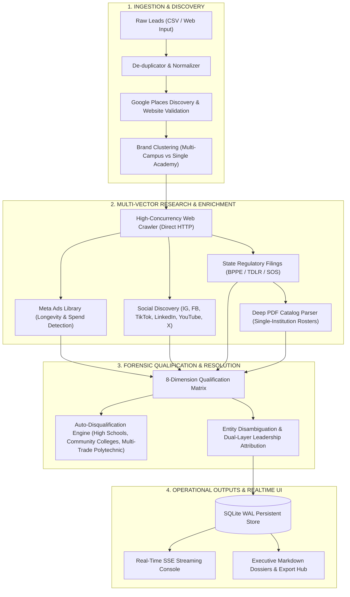
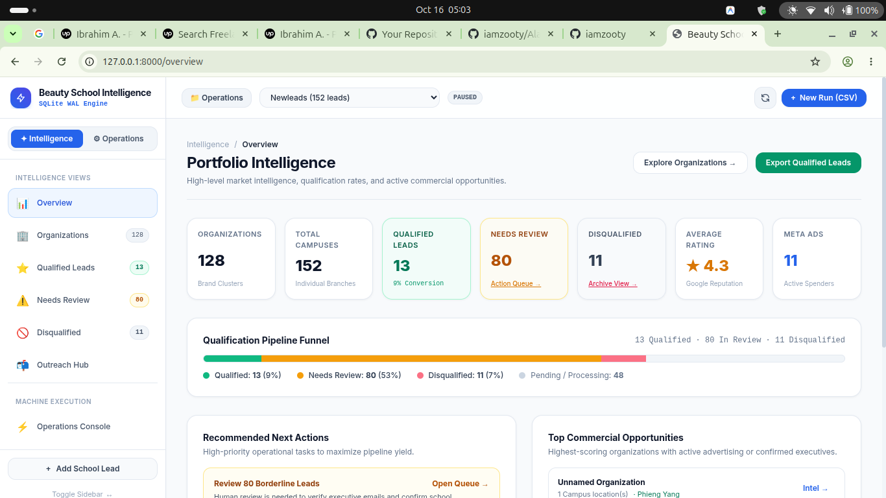
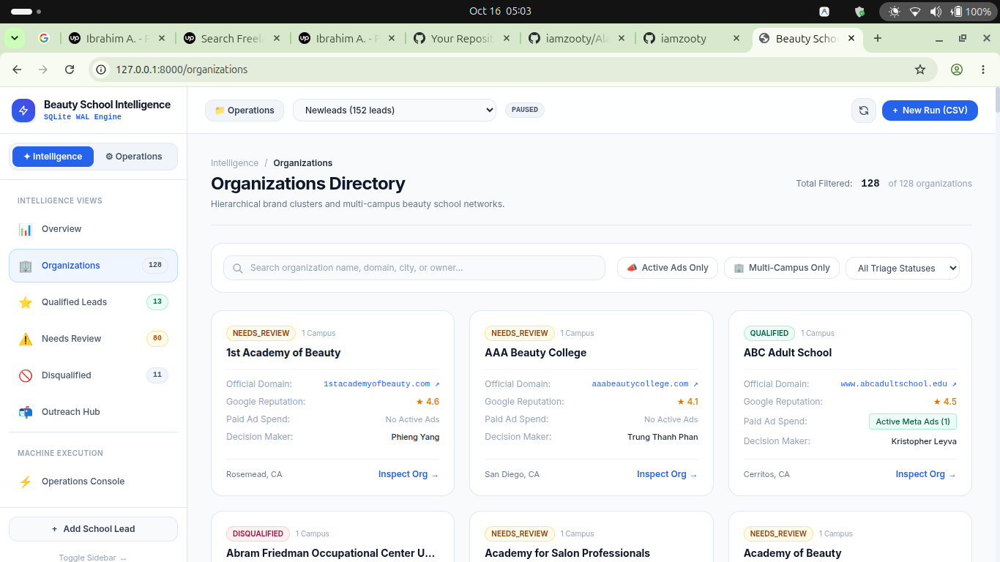
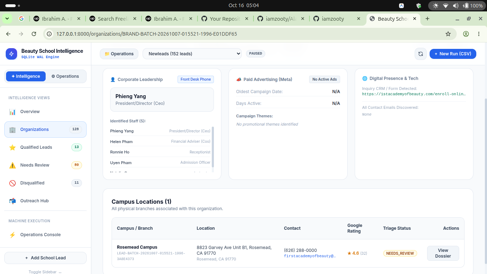
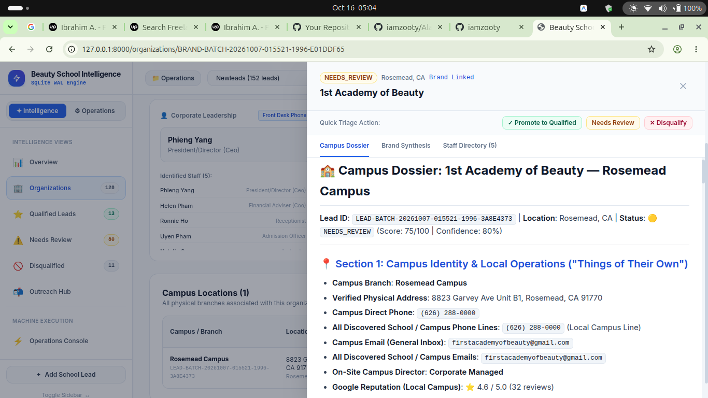
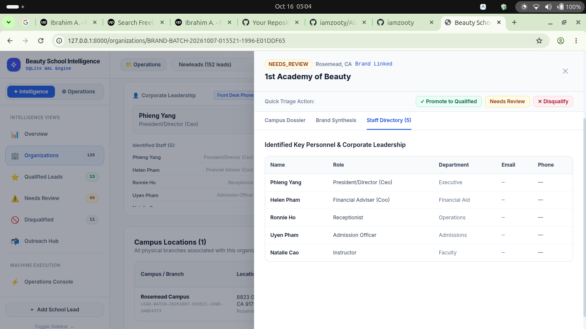
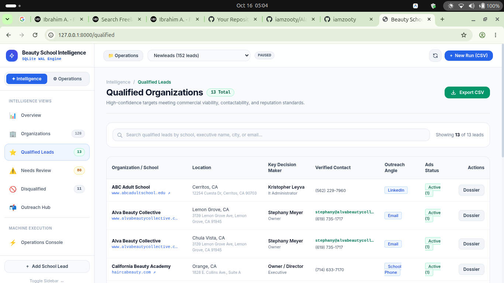
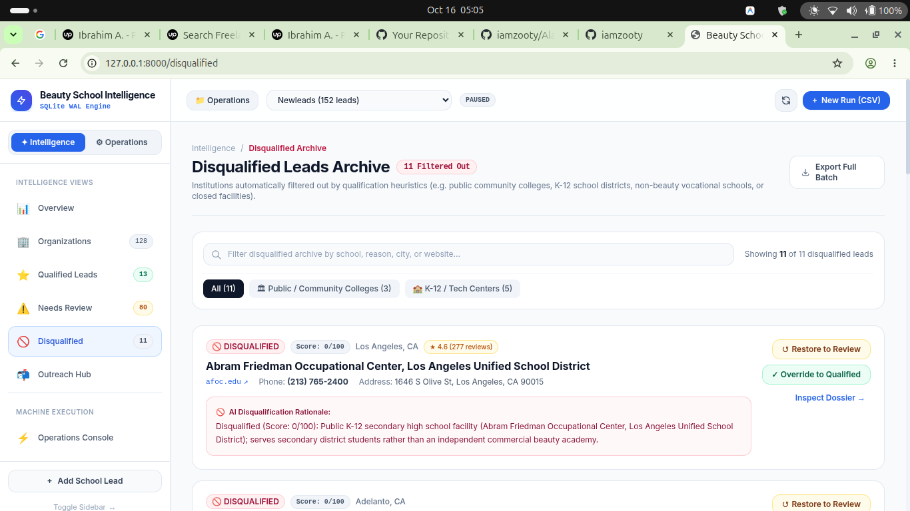
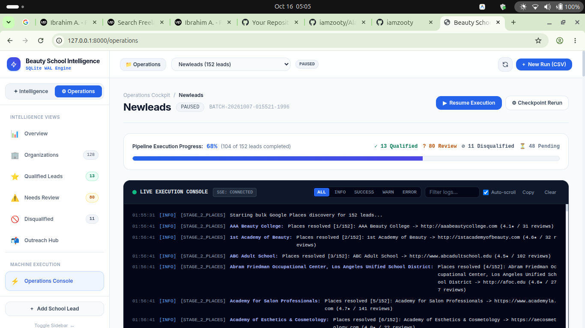
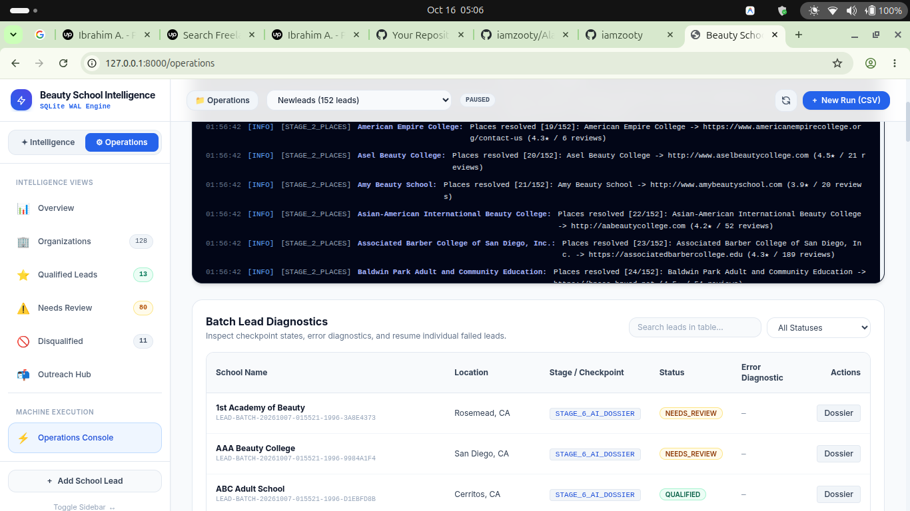

# ⚡ AI-Powered B2B Intelligence & Lead Qualification Pipeline
### *An Asynchronous, Forensic Entity Resolution & Multi-Channel Enrichment Engine*

<p align="center">
  
  
  
  
  
  
  
</p>

---

> ### 🔒 Client Confidentiality & Commercial Notice
> This repository is an **architectural case study and engineering breakdown** of a production intelligence system built for a private commercial client.
>
> In accordance with strict **Non-Disclosure Agreements (NDAs)** and proprietary intellectual property protections, the raw client business rules, proprietary scoring weights, production database records, and private API keys are excluded. This case study demonstrates the **high-level system design, complex engineering hurdles overcome** (anti-bot scraping resilience, state regulatory PDF parsing, multi-campus brand clustering, and forensic entity disambiguation), **verified test benchmarks**, and **production UI workflows**.

---

## 📌 Executive Summary

Modern B2B client acquisition pipelines suffer from high noise, outdated directories, and generic scraping failures:
- **Low-Quality Contacts**: Generic scrapers scrape `info@` or front-desk reception emails rather than verifiable decision-makers.
- **Bot Rate-Limiting**: Search engines and state portals quietly block single IP addresses mid-batch, causing decision-maker discovery to drop off silently.
- **Entity & Namesake Collisions**: Out-of-state entities with identical or similar names (e.g. *Master Academy* in California vs. *Fitness Master Academy* in Kansas) pollute CRM records.
- **Multi-Campus Confusion**: Corporate franchises and multi-location holding companies overwrite branch-specific campus directors with corporate office contacts.

To solve this, I architected and built **Beauty School Intelligence (Lead Cleaner)**: an asynchronous data pipeline and real-time operations console that enriches, qualifies, and generates executive dossiers for commercial vocational academies.

---

## 🏛️ System Architecture



---

## 🚀 Key Engineering Challenges & Solutions

### 1. Hybrid Scraping: Bypassing Silent Bot Throttling
* **The Problem**: Querying public leadership filings (Better Business Bureau, Secretary of State, State Licensing Boards) from a single IP address triggered silent CAPTCHA blocks after 30–50 consecutive leads, causing decision-maker detection to fall off mid-run.
* **The Solution**: Designed a **two-tier hybrid strategy**:
  - **Direct HTTP (Async HTTPX)**: Used for individual school domains and PDF catalogs. Because requests are spread across hundreds of independent domains, direct HTTP yields 1–2s response times with zero proxy overhead.
  - **Managed Apify Proxy Fallback**: External searches targeting centralized search engines automatically route through Apify's rotating residential proxy network with disk-backed MD5 query caching, completely eliminating IP throttling.

---

### 2. State Regulatory PDF Catalog Parsing
* **The Problem**: Modern Single-Page Applications (Next.js, Nuxt) often omit HTML faculty rosters or protect them behind JavaScript walls. However, states mandate annual filing of comprehensive 30+ page regulatory catalogs with full staff rosters and administrative contacts on government portals (`bppe.ca.gov`, `tdlr.texas.gov`).
* **The Solution**: 
  - Engineered an intelligent URL discriminator that isolates single-institution documents (`/document/<uuid>` or `.pdf`) from broad disciplinary aggregator lists.
  - Extracted text from PDF catalogs via in-memory streaming, parsed administrative sections using dynamic title anchor windows, and captured direct administrative email addresses (e.g. `maiquelaa@yahoo.com`) that never appeared on the public marketing site.

---

### 3. Forensic Entity Disambiguation & Namesake Collisions
* **The Problem**: A search for generic academy names like *"Master Academy"* matched out-of-state LinkedIn executives (e.g., Cody Deal, CEO of *Fitness Master Academy* in Wichita, KS) instead of the local director in California.
* **The Solution**:
  - Implemented strict **cross-state geographic and trade-domain boundaries**.
  - Profiles containing unrelated industry keywords (`fitness`, `gym`, `personal trainer`, `computer graphics`) or disparate US states without explicit California footprint are systematically disqualified before reaching the scoring engine.

---

### 4. Dual-Layer Leadership Attribution
* **The Problem**: Multi-location academies often have a corporate holding company owner alongside an active on-site campus director. Overwriting local campus directors with corporate executives destroys personalized outreach.
* **The Solution**:
  - Added dual-layer attribution in `DecisionMakerResolution`:
    - **Primary Executive**: Corporate Owner / President (e.g., Patricia Cochran).
    - **On-Site Operational Director**: Local Campus Director (e.g., Rebecca Abinales).
  - Maintained branch-level sibling guards in SQLite to ensure local campus directors are never overwritten by automated multi-campus propagation.

---

## 🖼️ Visual Tour & Production UI

### 1. Portfolio Intelligence & Pipeline Funnel
High-level operational overview featuring qualification conversion rates, commercial opportunities, and breakdown of leads across the 8-dimension matrix.


---

### 2. Hierarchical Organizations & Brand Directory
Automatic brand clustering grouping individual physical branches under unified parent networks while tracking Google reputation and active Meta ads.


---

### 3. Organization Synthesis & Multi-Campus Footprint
Detailed brand card displaying corporate officers, Meta ad campaign longevity, and branch-level performance.


---

### 4. Interactive Campus Intelligence Dossier
Comprehensive operational profile for each campus with direct verified contacts, department phone lines, and one-click triage controls (`Promote`, `Needs Review`, `Disqualify`).


---

### 5. Identified Staff & Key Personnel Directory
Extracted leadership directory parsed from website leadership pages, state licensing filings, and 30+ page regulatory PDF catalogs.


---

### 6. Qualified Commercial Opportunities
High-confidence target list filtered by active Meta advertising, verified commercial decision-makers, and tailored outreach channels (Email, LinkedIn, Phone).


---

### 7. Forensic Disqualification Archive
Automated audit log detailing exact rationale for disqualified leads (e.g., public K-12 school districts, community colleges, defunct corporate entities, polytechnic career colleges) with manual review overrides.


---

### 8. Real-Time Operations Cockpit & Live SSE Console
Asynchronous worker execution monitored via Server-Sent Events (SSE) with live log streaming, auto-scroll, log search, and execution controls.


---

### 9. Granular Batch Checkpoint Diagnostics
Fault-tolerant execution engine allowing granular restarts from any pipeline stage (`STAGE_1_INGESTION` through `STAGE_6_AI_DOSSIER`).


---

## 🧪 Rigorous Quality & Test Suite

The system maintains an automated test suite enforcing regression guards across all deduplication algorithms, crawlers, qualification heuristics, and API endpoints:

```bash
$ pytest -v
============================== test session starts ==============================
platform linux -- Python 3.12.3, pytest-9.1.1
collected 81 items

tests/test_brand_clustering.py ................                          [  4%]
tests/test_catalog_regulatory_discovery.py ..................            [ 19%]
tests/test_crawlers.py ................                                  [ 24%]
tests/test_csv_manager.py ....                                           [ 25%]
tests/test_deduplicator.py ............                                  [ 29%]
tests/test_entity_resolution_and_qualification.py ....                   [ 34%]
tests/test_intelligence.py ....................                          [ 40%]
tests/test_leadership_discovery.py ....................                  [ 51%]
tests/test_operations_checkpoints.py ....................                [ 59%]
tests/test_pipeline.py ........                                          [ 61%]
tests/test_qualification.py ...................................          [ 72%]
tests/test_repository.py ........                                        [ 75%]
tests/test_review_cli.py ....                                            [ 76%]
tests/test_utils.py ............................                         [ 85%]
tests/test_web_api.py ........................                           [ 92%]
tests/test_worker.py ................................                    [100%]

======================== 81 passed, 1 warning in 10.26s ========================
```

---

## 🛠️ Technology Stack

| Layer | Technologies |
| :--- | :--- |
| **Backend & API** | Python 3.12, FastAPI, Pydantic v2, Starlette |
| **Concurrency & Streaming** | Asyncio, HTTPX, Server-Sent Events (SSE), ThreadSafe Event Bus |
| **Database & Persistence** | SQLite (WAL mode, Write-Ahead Logging for high concurrency), JSON storage |
| **Data Extraction & Scraping** | Apify Managed Actors, BeautifulSoup4, PyPDF, Regex Engines |
| **AI & NLP Analysis** | Google Gemini 1.5 Pro & Flash via Structured Pydantic Output Schemas |
| **Testing & CI/CD** | Pytest, Pytest-Asyncio, AnyIO, Strict Regression Fixtures |

---

## 👤 About the Author

**Ibrahim A. (iamzooty)**  
*Senior Full-Stack & Python Data Systems Engineer*

Specializing in scalable data pipelines, asynchronous web crawlers, AI-augmented automation, and high-performance backend architectures.

- 💼 **Upwork Profile**: [https://www.upwork.com/freelancers/~0190f7e2501c7c5a85](https://www.upwork.com/freelancers/~0190f7e2501c7c5a85)
- 🔗 **LinkedIn**: [https://www.linkedin.com/in/iamzooty/](https://www.linkedin.com/in/iamzooty/)
- 💻 **GitHub**: [https://github.com/iamzooty](https://github.com/iamzooty)
- 💬 **Stack Overflow**: [@iamzooty](https://stackoverflow.com/users/iamzooty)

---
*For contract inquiries, custom data pipelines, or architecture consulting, please reach out via [Upwork](https://www.upwork.com/freelancers/~0190f7e2501c7c5a85) or [LinkedIn](https://www.linkedin.com/in/iamzooty/).*
